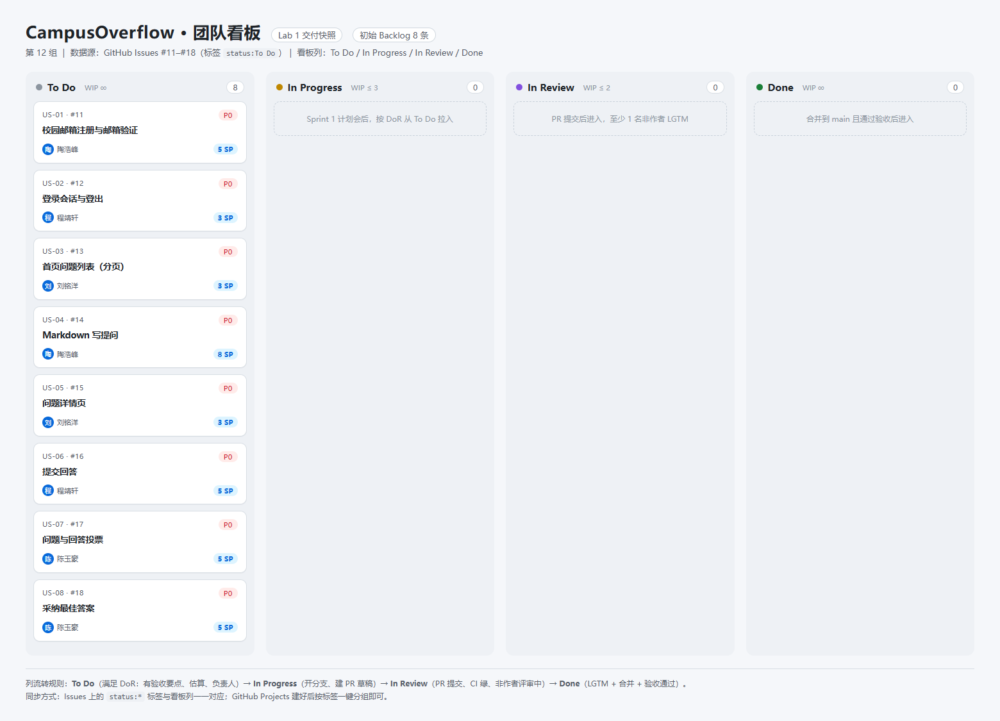

# Lab 1 · 团队看板（CampusOverflow 初始 Backlog）

> 第 12 组｜Lab 1 协作工具链产出｜维护人：陈玉豪（SM）
> 数据源：GitHub Issues **#11–#18**（标签 `status:To Do`）｜快照：2026-11-26

---

## 1. 看板结构

| 列 | 含义 | WIP 限制 | 进入条件 |
|---|---|---|---|
| **To Do** | 已排进 Backlog、尚未开始 | 不限 | 有用户故事、验收要点、估算与负责人（DoR） |
| **In Progress** | 正在开发 | ≤ 3 | 已从 `main` 切出功能分支，PR 以草稿提交 |
| **In Review** | 代码评审中 | ≤ 2 | PR 已提交、CI 绿、至少 1 名非作者在评审 |
| **Done** | 已验收 | 不限 | 评审 LGTM + 合并 `main` + 验收要点逐条通过（DoD） |

WIP 限制的作用：同时进行的卡片超过上限时，站会必须先合流或拆小，避免"都在做、都没完"。

---

## 2. 初始 Backlog（8 条，均来自 `docs/backlog/product-backlog.md`）

| 看板列 | ID | 用户故事 | Issue | 负责人 | 优先级 | 估算 |
|---|---|---|---|---|---|---|
| To Do | US-01 | 校园邮箱注册与邮箱验证 | [#11](https://github.com/hbuas-se-2026fall/cs2412-team12-campus-overflow/issues/11) | 陶浩峰 | P0 | 5 SP |
| To Do | US-02 | 登录会话与登出 | [#12](https://github.com/hbuas-se-2026fall/cs2412-team12-campus-overflow/issues/12) | 程靖轩 | P0 | 3 SP |
| To Do | US-03 | 首页问题列表（分页） | [#13](https://github.com/hbuas-se-2026fall/cs2412-team12-campus-overflow/issues/13) | 刘铭洋 | P0 | 3 SP |
| To Do | US-04 | Markdown 写提问 | [#14](https://github.com/hbuas-se-2026fall/cs2412-team12-campus-overflow/issues/14) | 陶浩峰 | P0 | 8 SP |
| To Do | US-05 | 问题详情页 | [#15](https://github.com/hbuas-se-2026fall/cs2412-team12-campus-overflow/issues/15) | 刘铭洋 | P0 | 3 SP |
| To Do | US-06 | 提交回答 | [#16](https://github.com/hbuas-se-2026fall/cs2412-team12-campus-overflow/issues/16) | 程靖轩 | P0 | 5 SP |
| To Do | US-07 | 问题与回答投票 | [#17](https://github.com/hbuas-se-2026fall/cs2412-team12-campus-overflow/issues/17) | 陈玉豪 | P0 | 5 SP |
| To Do | US-08 | 采纳最佳答案 | [#18](https://github.com/hbuas-se-2026fall/cs2412-team12-campus-overflow/issues/18) | 陈玉豪 | P0 | 5 SP |

合计 **42 SP**，均为 P0（MVP 必需）。后续 US-09～US-24 在 Sprint 2–4 的迭代计划会上逐步拉入。

> 说明：截图是 Lab 1 交付时的状态——8 条全部在 **To Do**，其余三列为空并标注了进入条件。
> 随着 Sprint 推进，卡片按"标签 `status:*` → 看板列"的规则流转。

---

## 3. 卡片与 Issue 的对应关系

看板列不单独存数据，**以 Issue 的标签为准**：

| 看板列 | Issue 标签 |
|---|---|
| To Do | `status:To Do` |
| In Progress | `status:In Progress` |
| In Review | `status:In Review` |
| Done | `status:Done` |

这样在 Issues 列表里按标签过滤就能看到每一列，任何成员改标签即等于拖卡片，不依赖某个人手动维护看板。

---

## 4. 同步到 GitHub Projects（需 1 分钟手工）

当前仓库的 API Token 只有 `repo / gist / workflow` 权限，**没有 `project` 权限**，所以无法用脚本直接创建 Projects 看板。
建议由组长在网页上点三下完成（之后可长期使用）：

1. 仓库首页 → **Projects** 标签 → **New project** → 选 **Board**；
2. 项目设置里把 Status 选项改为：`To Do` / `In Progress` / `In Review` / `Done`；
3. 在 **Add items** 里搜索 `label:"status:To Do"`，一次把 #11–#18 全部加入；以后新 Issue 用 "Add to project" 即可。

> 加入后，Projects 的 Board 视图即为与截图一致的正式看板；本文件与 `kanban.png` 是可归档的快照。

---

## 5. 流转规则（DoR / DoD）

**DoR（进入 To Do 前必须满足）**

- 写成"作为…我希望…以便…"的用户故事，有明确角色；
- 至少 3 条可验证的验收要点；
- 有估算（SP）与负责人；
- 依赖关系写明（如 US-02 依赖 US-01）。

**DoD（进入 Done 前必须满足）**

- 验收要点逐条演示通过；
- PR 至少 1 名非作者 LGTM，CI 绿（测试 + 覆盖率 + Checkstyle）；
- 文档/接口契约（`docs/api/openapi.yaml`）同步更新；
- 合并到 `main` 后 Issue 打 `status:Done` 并关闭。

---

## 6. 维护约定

| 时机 | 动作 | 负责人 |
|---|---|---|
| 每日站会前 | 各人把自己卡片的 `status:*` 更新到实际状态 | 全员 |
| 站会中 | 检查 In Progress ≤ 3、In Review ≤ 2 | SM |
| 迭代计划会 | 从 Product Backlog 拉新卡到 To Do，补验收要点 | PO |
| 迭代评审后 | Done 卡片关闭，未完成卡片回到 To Do 并说明原因 | SM |

---

## 7. Lab 1 其它工具链事项（现状）

| 要求 | 状态 | 说明 |
|---|---|---|
| 团队代码仓库 URL | ✅ | <https://github.com/hbuas-se-2026fall/cs2412-team12-campus-overflow> |
| 看板（≥5 条初始 Backlog） | ✅ | 本文 + `kanban.png` + Issues #11–#18 |
| 分支保护（main 禁直推、PR 需评审） | ⚠️ 未配置 | 当前 API 返回 404；配置步骤见下 |
| 《团队章程 v1.0》 | ✅ | [`docs/team/charter-v1.0.md`](../team/charter-v1.0.md) |
| 每位成员首次 PR 合并记录 | ✅ | PR #1–#10（含 `docs/team/hello-*.md` 的首次合并） |

**开启分支保护的步骤**（需要仓库 Admin 在网页操作）：

1. Settings → Branches → Add branch protection rule；
2. Branch name pattern：`main`；
3. 勾选 **Require a pull request before merging**（Required approvals = 1）；
4. 勾选 **Do not allow bypassing the above settings**（团队约定管理员也走 PR）；
5. 可选：Require status checks 选 `backend · mvn verify…` 与 `frontend · lint + typecheck + build`。
