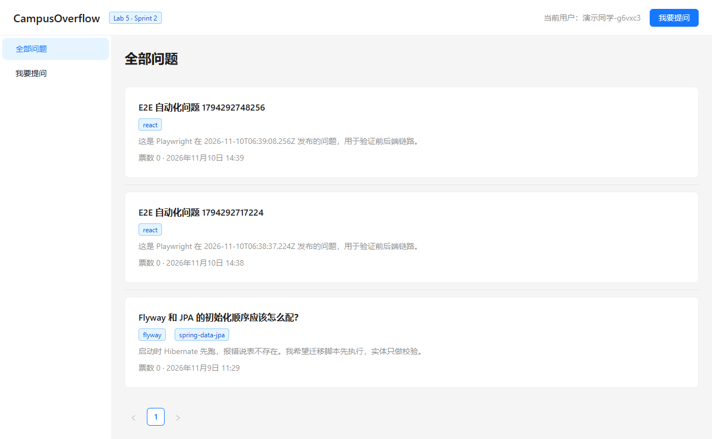
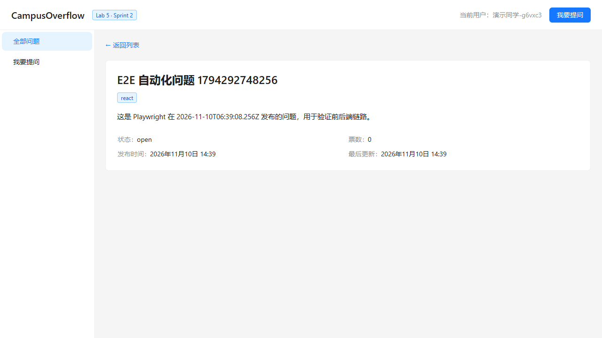

# Lab 5 本地验证记录（真实后端 + 真实浏览器）

> 记录人：第 12 组（PO 倪昊宇 / SM 陈玉豪、刘铭洋 / Dev 陶浩峰、程靖轩）
> 验证时间：2026-11-10
> 目的：Lab 5 的四条提交物里，前三条能靠命令自证，第四条「端到端跑通」必须有一次真实浏览器 + 真实后端的证据——本文就是这份证据。

## 0. 环境

| 项 | 值 |
|---|---|
| 操作系统 | Windows 11 |
| Node.js | 24.21.0 |
| pnpm | 12.8.1 |
| 前端 | Vite 6.4.5 + React 18.3 + TypeScript 5.6.3 |
| 浏览器 | 本机 Microsoft Edge（Playwright `channel: 'msedge'`） |
| 后端 | Lab 4 Spring Boot 3.5.6（`localhost:8080`） |
| 数据库 | MySQL 8.4.8，库 `campus_overflow` |

---

## 1. 提交物①：`pnpm dev` 可启动，首页可访问

```text
$ pnpm dev

  VITE v6.4.5  ready in 1401 ms

  ➜  Local:   http://localhost:5173/
```

- 根路径 `/` 重定向到 `/questions`；
- 首次进入会自动调用 `POST /api/v1/users` + `POST /api/v1/users/{id}/email-verification` 准备演示账号，
  AppShell 右上角显示「当前用户：演示同学-xxxxxx」；
- Vite 把 `/api` 代理到 `http://localhost:8080`，前端代码里不写死后端地址。

---

## 2. 提交物②：`pnpm lint` 与 `pnpm typecheck` 全绿

```text
$ pnpm typecheck
$ tsc --noEmit
typecheck exit = 0

$ pnpm lint
$ eslint . --max-warnings 0
lint exit = 0

$ pnpm build
dist/index.html                   0.48 kB │ gzip:   0.33 kB
dist/assets/index-Cje7FDxR.css    3.20 kB │ gzip:   1.31 kB
dist/assets/index-Cdxhzlm2.js   978.94 kB │ gzip: 314.66 kB
✓ built in 18.92s
build exit = 0
```

严格模式配置（`tsconfig.json`）：`strict`、`noUncheckedIndexedAccess`、`noUnusedLocals`、`noUnusedParameters`。

业务代码零 `any`，由 ESLint 规则 `@typescript-eslint/no-explicit-any: error` + `--max-warnings 0` 兜住；
唯一豁免目录是生成的 `src/api/generated/**`。

---

## 3. 提交物③：pre-commit 钩子拦截实测

做法：故意新建一个含 `any` 的文件并 `git add` 后提交。

```text
$ git add frontend/src/__hook_probe.ts
$ git commit -m "test: 验证 pre-commit 钩子（应被拦截）"

[STARTED] Reverting to original state because of errors...
✖ eslint --fix:
frontend/src/__hook_probe.ts
  2:14  error  Unexpected any. Specify a different type  @typescript-eslint/no-explicit-any
✖ 1 problem (1 error, 0 warnings)

commit exit = 1
```

结论：钩子生效——**不合规提交被拦下，没有产生 commit**（随后已 `git reset` 并删除探针文件）。

钩子构成：

```sh
# 仓库根 .husky/pre-commit
cd frontend
pnpm exec lint-staged --relative   # 只处理暂存区文件
pnpm typecheck                     # 全量类型检查，防 any 逃逸
```

> 为什么钩子放在仓库根：前端在 `frontend/` 子目录，git 只能从仓库根执行钩子；
> `scripts/install-git-hooks.mjs` 在 `pnpm install` 时把 `core.hooksPath` 指向 `.husky`。

---

## 4. 提交物④：提问 → 列表 → 详情 端到端跑通

### 4.1 自动化执行（真实 Edge 浏览器）

```text
$ pnpm e2e

Running 1 test using 1 worker

  ok 1 [msedge] › e2e\lab5.spec.ts:12:1 › 提问 → 详情 → 列表 端到端贯通 (5.7s)

  1 passed (11.2s)
```

用例做了什么：

1. 打开 `/questions/new`，等待演示账号就绪（表单可用）；
2. 填写标题与正文；
3. 打开标签下拉，**输入 `react` 过滤后回车**选中（antd 选项是虚拟列表，直接点 title 找不到未渲染项）；
4. 点「发 布」→ 跳到 `/questions/{uuid}`；
5. 详情页断言标题与正文可见；
6. 回到 `/questions`，断言新问题出现在列表；
7. 直接访问详情 URL，断言可回访。

### 4.2 视觉证据

- 列表页：
- 详情页：
- 录屏（5.7 秒，Playwright 录制）：[`screenshots/e2e-demo.webm`](screenshots/e2e-demo.webm)

### 4.3 数据库实际写入

E2E 结束后查库：

```text
mysql> SELECT id, title, tags, status, created_at FROM question ORDER BY created_at DESC LIMIT 3\G
*************************** 1. row ***************************
        id: 3efcb932-9d3b-4285-ba2a-aa7809a596e8
     title: E2E 自动化问题 1794292717224
      tags: react
    status: open
created_at: 2026-11-10 06:38:40.162199
*************************** 2. row ***************************
        id: a92d053f-0661-4dfb-9fbf-852a3e5d3760
     title: Flyway 和 JPA 的初始化顺序应该怎么配？
      tags: flyway,spring-data-jpa
    status: open
created_at: 2026-11-09 03:29:04.797281
```

> 第二行是 Lab 4 验证时写入的历史数据，说明前端读的是**同一张表**，不是内存 mock。

### 4.4 链路

```
Edge(5173)
  → Vite dev server /api 代理
    → Spring Boot(8080) QuestionController
      → QuestionApplicationService（AskerVerifier 校验 INV-U-02）
        → Question 聚合（Title/Body/TagSet 校验 INV-Q-01/02）
          → MySQL question 表
```

---

## 5. 过程中踩到并修掉的坑（留痕）

| # | 现象 | 根因 | 修复 |
|---|---|---|---|
| 1 | `pnpm create vite` 生成的模板是 React 19 + oxlint + TS 7 | Vite 模板已升级，与 Lab 5 要求的 React 18 / TS 5 / ESLint 不一致 | 手工把依赖钉回 React 18.3 + TS 5.6 + Vite 6，ESLint 9 + typescript-eslint 8 |
| 2 | `pnpm install` 报 `ERR_PNPM_IGNORED_BUILDS` | pnpm 12 默认不允许依赖执行构建脚本（esbuild） | `pnpm-workspace.yaml` 写 `onlyBuiltDependencies: [esbuild]` 并 `pnpm approve-builds --all` |
| 3 | `tsc` 报 `Cannot find module 'form-data'` | 生成的 axios 模板 import 了 Node 专用包 | 新增 `scripts/patch-generated.mjs`，生成后自动换成原生 `FormData`（`pnpm api:generate` 链式执行） |
| 4 | E2E 点标签超时 | antd Select 选项是虚拟列表，`react` 未渲染 | 改成「点击 → 输入过滤 → 回车」 |
| 5 | E2E 找不到「发布」按钮 | antd 在两个中文字之间插入空格，可访问名是「发 布」 | 用正则 `/发\s*布/` 匹配 |
| 6 | 第二次跑 E2E 时前端 5173 已断开 | 手工启动的 dev server 进程被回收 | Playwright 配 `webServer` 自动拉起与回收；并把 `playwright-report/`、`test-results/` 加入 Vite watch 忽略，避免报告文件触发 HMR 重载 |

第 3 条尤其值得写进 ADR/README：**生成产物不要手改，改生成后的补丁脚本**，否则下次 `api:generate` 会把修复冲掉。

---

## 6. 复现步骤

```bash
# 0) 数据库与后端（Lab 4）
mysql -uroot -p -e "CREATE DATABASE IF NOT EXISTS campus_overflow DEFAULT CHARACTER SET utf8mb4"
mvn clean install
java -jar co-bootstrap/target/campus-overflow.jar

# 1) 前端
cd frontend
pnpm install
pnpm typecheck && pnpm lint && pnpm build

# 2) 开发服务器
pnpm dev            # http://localhost:5173

# 3) 端到端（另开终端；Playwright 会自动拉起 dev server）
pnpm e2e
```
