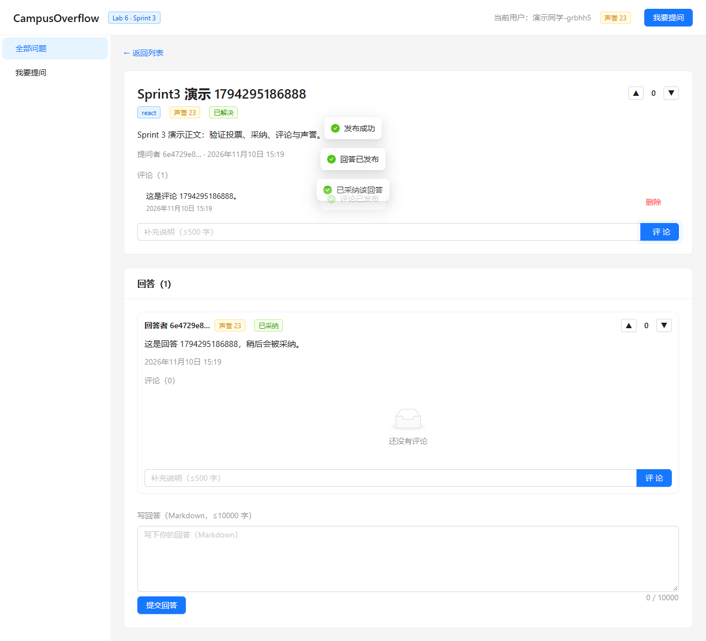
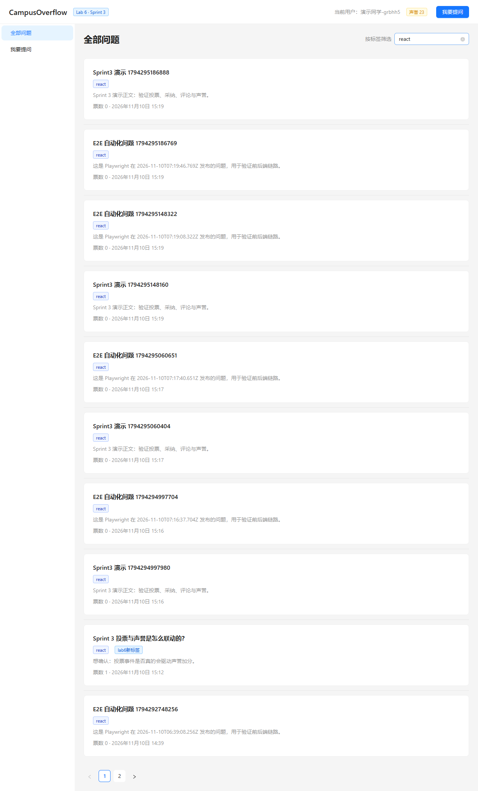
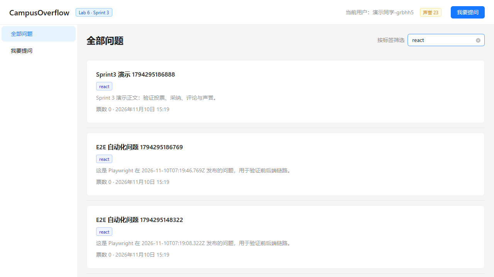

# Lab 6 验证记录（Sprint 3 增量 · 真实 MySQL + 真实浏览器）

> 记录人：第 12 组（PO 倪昊宇 / SM 陈玉豪、刘铭洋 / Dev 陶浩峰、程靖轩）
> 验证时间：2026-11-10
> 目的：Lab 6 的提交物①要求"Sprint 3 增量在 main 可演示"——本文给出**可复现的命令与真实输出**，
> 覆盖投票、采纳、评论、标签、声誉五条链路，以及跨模块事件链。

## 0. 环境

| 项 | 值 |
|---|---|
| JDK / Maven | Temurin 21.0.12 / Maven 3.9.16 |
| MySQL | 8.4.8（`127.0.0.1:3306/campus_overflow`） |
| 前端 | Vite 6.4.5 + React 18.3 + TS 5.6 |
| 浏览器 | 本机 Edge（Playwright `channel: 'msedge'`） |
| 后端 | Spring Boot 3.5.6，端口 8080 |

---

## 1. 构建与测试：50 个测试全绿

```text
[INFO] Tests run: 6,  Failures: 0, Errors: 0, Skipped: 0  -- UserTest
[INFO] Tests run: 27, Failures: 0, Errors: 0, Skipped: 0  -- QuestionTest / AnswerTest / VoteTest / TagSetTest
[INFO] Tests run: 5,  Failures: 0, Errors: 0, Skipped: 0  -- ReputationAccountTest
[INFO] Tests run: 6,  Failures: 0, Errors: 0, Skipped: 0  -- QuestionApiIntegrationTest
[INFO] Tests run: 6,  Failures: 0, Errors: 0, Skipped: 0  -- Sprint3ApiIntegrationTest
[INFO] BUILD SUCCESS
```

其中 `Sprint3ApiIntegrationTest` 是本 Sprint 新增的 6 个端到端用例：

| 用例 | 断言要点 |
|---|---|
| 回答 → 采纳 | 回答者声誉 **21**（1 + 5 + 15），提问者 **3**（1 + 2） |
| 投票流程 | 赞成 → 1、改反对 → −1、撤票 → 0，票数投影与接口一致 |
| 不能自投 | 返回 `INV-V-02` |
| 评论生命周期 | 发/列/非作者删（`INV-C-03`）/作者删 |
| 标签筛选 | `GET /questions?tag=X` 命中刚发的问题，`GET /tags` 能查到 |
| 回答限流 | 60 秒内重复回答返回 `INV-A-03` |

---

## 2. Flyway V2（Sprint 3 schema）在已有数据库上升级成功

```json
{"message":"Current version of schema `campus_overflow`: 1"}
{"message":"Migrating schema `campus_overflow` to version \"2 - sprint3 schema\""}
{"message":"Successfully applied 1 migration to schema `campus_overflow`, now at version v2 (execution time 00:00.703s)"}
```

迁移做了三件事：建 `vote` / `comment` / `tag` / `question_tag` / `reputation_account` / `reputation_entry`；
给 `answer` 加 `vote_count`；用递归 CTE 把历史 `question.tags` 回填进 `question_tag`（回填结果见 §5）。

---

## 3. 接口链路（真实 HTTP）

### 3.1 A 提问（带一个词表外的新标签）

```http
POST /api/v1/questions
{"askerId":"b9e6…","title":"Sprint 3 投票与声誉是怎么联动的？","body":"…","tags":["react","lab6新标签"]}
```

```json
HTTP 201
{"id":"7ba96482-…","tags":["react","lab6新标签"],"status":"open","voteCount":0}
```

> 未知标签不再 400，而是自动登记（US-10；INV-Q-02 在 ADR-003 中有修订说明）。

### 3.2 B 回答，A 采纳

```json
POST /api/v1/answers        → 201 {"id":"d7ae4d51-…","status":"normal","accepted":false,"voteCount":0}
POST /api/v1/questions/{id}/acceptance → 200 {"status":"solved","acceptedAnswerId":"d7ae4d51-…"}
```

### 3.3 B 给 A 的问题投赞成票

```json
POST /api/v1/votes
{"targetType":"QUESTION","targetId":"7ba96482-…","voterId":"a3d3…","value":"up"}

HTTP 200
{"targetType":"question","targetId":"7ba96482-…","voterId":"a3d3…","value":"up","targetVoteCount":1}
```

### 3.4 评论与标签筛选

```json
POST /api/v1/comments → 200 {"id":"551997cb-…","body":"补充：这条评论用于验证 US-09。"}

GET /api/v1/questions?tag=react
→ 200 {"items":[{"id":"7ba96482-…","tags":["react","lab6新标签"],"voteCount":1}, …],"total":3}
```

### 3.5 声誉（事件链结果）

```json
GET /api/v1/users/{B}/reputation
→ 200 {"score":21,"entries":[
    {"ruleCode":"ANSWER_ACCEPTED","delta":15},
    {"ruleCode":"ANSWER_SUBMITTED","delta":5}]}

GET /api/v1/users/{A}/reputation
→ 200 {"score":13,"entries":[
    {"ruleCode":"UPVOTE_RECEIVED","delta":10},
    {"ruleCode":"QUESTION_POSTED","delta":2}]}
```

> 分数由 `QaReputationListener` 在源事务提交后写入，不是业务代码里手算的——
> 这正是 Lab 6 要求的"身份/问答模块通过领域事件影响声誉模块"。

---

## 4. 数据库核对

```text
mysql> SHOW TABLES;
answer  comment  flyway_schema_history  question  question_tag
reputation_account  reputation_entry  tag  user  vote

mysql> SELECT target_type, target_id, voter_id, vote_value FROM vote;
question  7ba96482-…  a3d34dbf-…  up

mysql> SELECT user_id, rule_code, delta FROM reputation_entry ORDER BY created_at DESC LIMIT 4;
b9e6b222-…  UPVOTE_RECEIVED   10
a3d34dbf-…  ANSWER_ACCEPTED   15
a3d34dbf-…  ANSWER_SUBMITTED   5
b9e6b222-…  QUESTION_POSTED    2

mysql> SELECT * FROM question_tag WHERE question_id = '7ba96482-…';
7ba96482-…  lab6新标签
7ba96482-…  react

mysql> SELECT installed_rank, version, description, success FROM flyway_schema_history;
1  1  init schema     1
2  2  sprint3 schema  1
```

---

## 5. 前端端到端（真实 Edge）

```text
$ pnpm e2e
Running 2 tests using 2 workers

  ok 1 [msedge] › e2e/lab5.spec.ts › 提问 → 详情 → 列表 端到端贯通 (9.5s)
  ok 2 [msedge] › e2e/lab6.spec.ts › Sprint 3：回答、采纳、评论、投票、标签筛选与声誉 (13.1s)

  2 passed (19.5s)
```

Lab 6 用例覆盖：**发问 → 回答 → 采纳 → 评论 → 对"别人的问题"投赞成（票数 0→1）→ 标签筛选 → 声誉接口断言 ≥23**。

视觉证据：

- 详情页（投票、声誉徽章、已采纳、评论、回答表单）：
  
- 按标签筛选 + 当前用户声誉 23：
  
- 列表页与声誉徽章：
  
- 录屏（13 秒，Playwright 录制）：[`screenshots/sprint3-demo.webm`](screenshots/sprint3-demo.webm)

---

## 6. 本 Sprint 修掉的跨模块 BUG（Lab 6 要求 1–2 个，实际 3 个）

| # | 现象 | 根因 | 修复 |
|---|---|---|---|
| 1 | 改判采纳后旧作者的 +15 不扣 | `AnswerAccepted` 没带旧作者 ID，声誉侧无法反查 | 事件新增 `acceptedAnswerAuthorId` / `previousAnswerAuthorId`，监听器写 `AR:` 冲正明细 |
| 2 | 改票后声誉按"新值"算，少扣 12 分 | 事件只带当前值，丢失旧值 | 事件携带 `reputationDelta`（新贡献 − 旧贡献） |
| 3 | H2 测试环境 `vote` 表建不出来 | 列名 `value` 是 SQL 保留字 | 列改名 `vote_value`，迁移与实体同步 |

第 1、2 条是典型的"单模块测试全绿、跨模块链路错"——只有把事件、监听器、声誉落库连起来测才会暴露，
与 Lab 6"排查跨模块协作 BUG"的目标一致。

---

## 7. 已知瑕疵（不算缺陷，记录以免误判）

| 项 | 说明 |
|---|---|
| 生成客户端的中文 JSDoc 乱码 | `openapi-typescript-codegen` 在 Windows 下按非 UTF-8 解码 YAML，生成文件里的注释出现乱码；不影响类型与运行，源文档 `docs/api/openapi.yaml` 正常 |
| 票数/声誉可能短暂滞后 | 事件在提交后处理，页面刷新后一致（最终一致，见 ADR-003） |
| antd 按钮文案中带空格 | "发 布""评 论"等在可访问名里有空格，E2E 用正则匹配 |

---

## 8. 复现步骤

```bash
# 0) 数据库（已有 Lab 4/5 数据也可以，V2 会增量升级）
mysql -uroot -p -e "CREATE DATABASE IF NOT EXISTS campus_overflow DEFAULT CHARACTER SET utf8mb4"

# 1) 后端
mvn clean install
java -jar co-bootstrap/target/campus-overflow.jar

# 2) 前端
cd frontend && pnpm install && pnpm dev

# 3) 端到端
cd frontend && pnpm e2e
```
